# ReqTrace v0.2.0: Canonical Architecture Package

This document defines the canonical architecture specification for **ReqTrace v0.2.0 (Local Verification Workspace)**. It serves as the authoritative blueprint for engineering teams, safety certification auditors (DO-178C, DO-254, ISO 26262, IEC 62304), open-core contributors, and system operators.

---

## 1. High-Level Product Architecture

ReqTrace operates as a local-first, air-gapped verification cockpit. It ingests requirements specifications and test artifacts, deterministically establishes trace links, orchestrates human review sign-offs, and exports defensible audit deliverables.

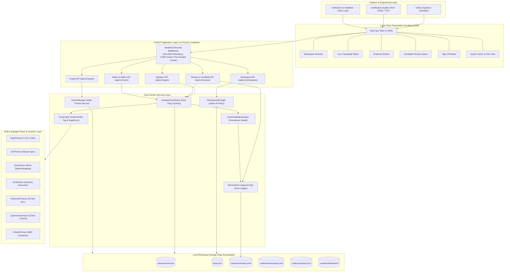

---

## 2. Runtime Component Architecture

The runtime architecture decouples HTTP transport controllers from core domain services and delegates all heavy computational analysis to an incremental `AnalysisCoordinator`.

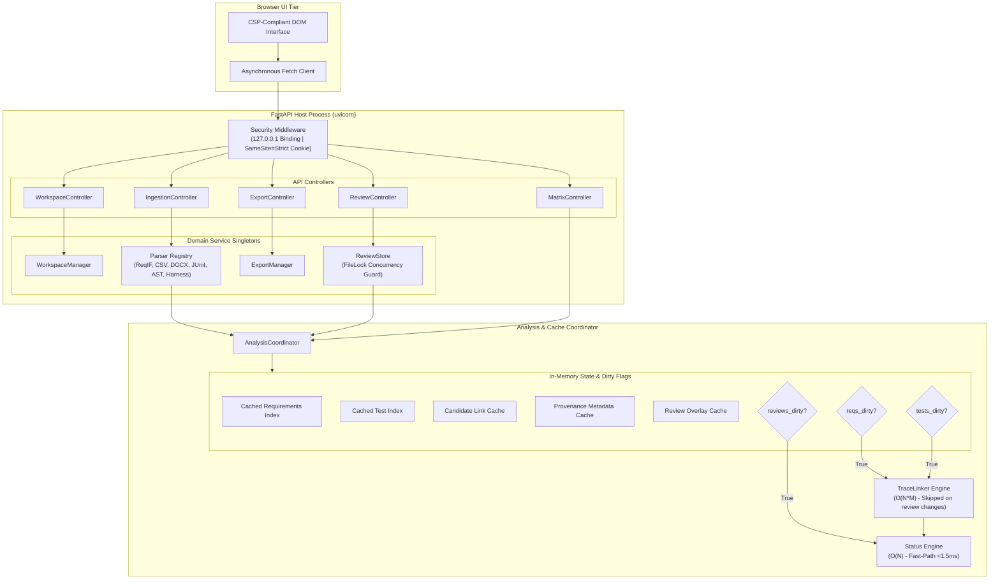

---

## 3. Workspace Storage & Manifest Architecture

ReqTrace workspaces follow strict data sovereignty: all specifications, tests, reviews, and project baselines are stored on the local file system. Target directories must exist prior to workspace creation (**Option B Policy**).

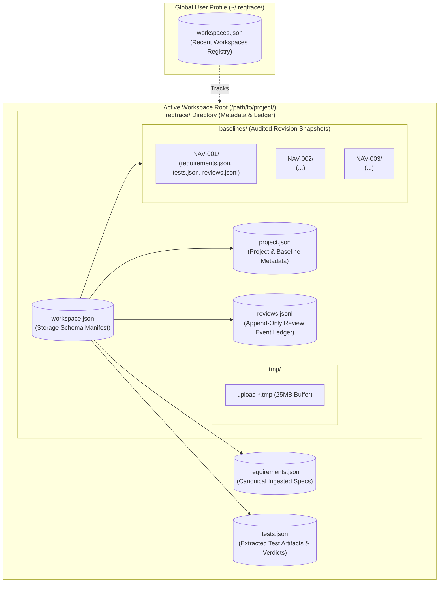

### Directory Tree Layout

```text
workspace-root/
├── requirements.json              # Primary ingested requirements repository
├── tests.json                     # Primary test cases with dynamic execution verdicts
└── .reqtrace/
    ├── workspace.json             # Manifest declaring active schema version and file paths
    ├── project.json               # Project name, spec revision, baseline ID, and timestamps
    ├── reviews.jsonl              # Cryptographically content-bound append-only review ledger
    ├── tmp/                       # Temporary atomic upload buffer
    └── baselines/
        ├── NAV-001/               # Immutable historical audit snapshot Rev A
        │   ├── project.json
        │   ├── requirements.json
        │   ├── tests.json
        │   ├── reviews.jsonl
        │   └── trace_matrix.csv
        ├── NAV-002/               # Historical audit snapshot Rev B
        └── NAV-003/               # Current baseline Rev C
```

---

## 4. Processing Pipeline & Fast-Path Triage Flow

This sequence models the end-to-end lifecycle from specification upload to candidate triage, human sign-off, and status calculation. It visualizes the **Architectural Performance Invariant**: human review sign-offs bypass the $O(N \times M)$ text linker.

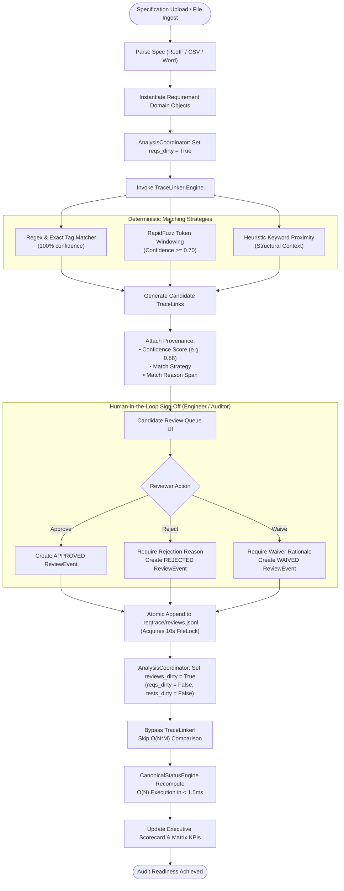

---

## 5. Unified Export Architecture

The `ExportManager` decouples export formats from web controllers, assembling a consistent point-in-time workspace snapshot before calculating SHA-256 verification hashes for compliance defensibility.

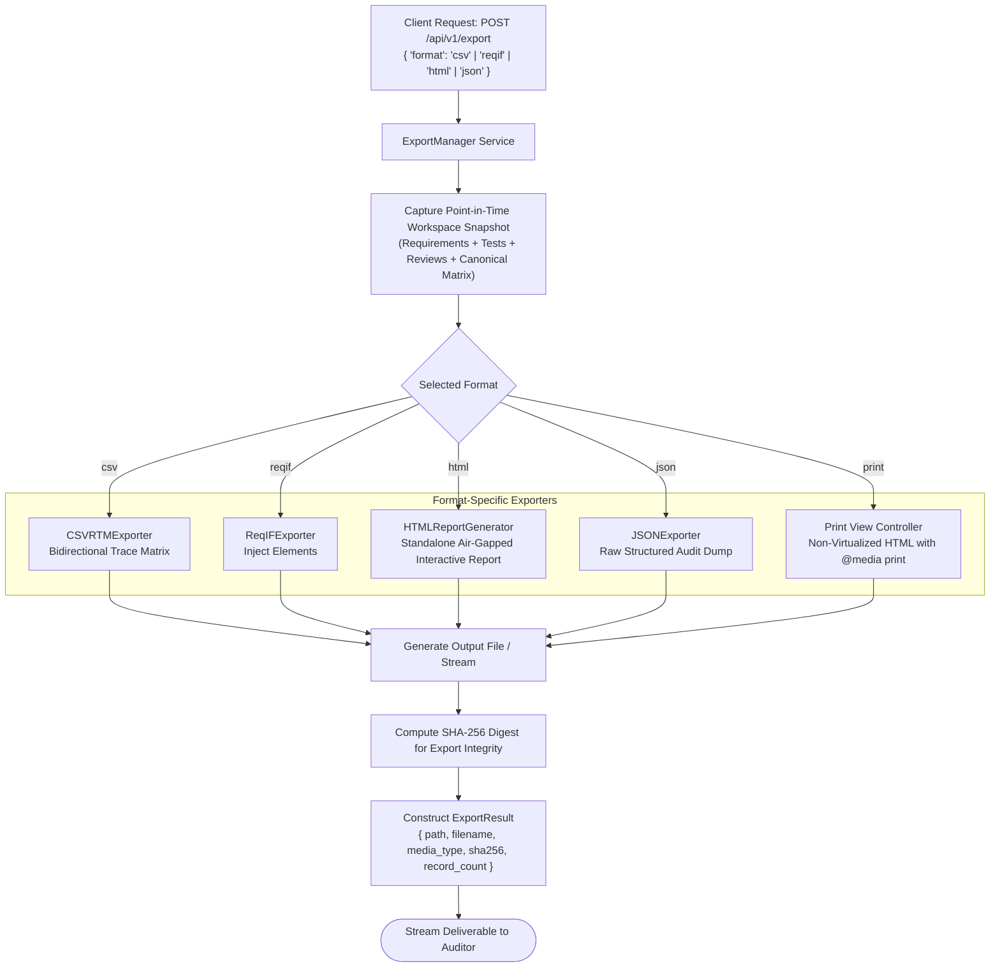

---

## 6. Deployment Architectures

### 6.1 Local Air-Gapped Workstation Deployment

Designed for individual safety engineers working on isolated, classified, or air-gapped workstations without external network connectivity.

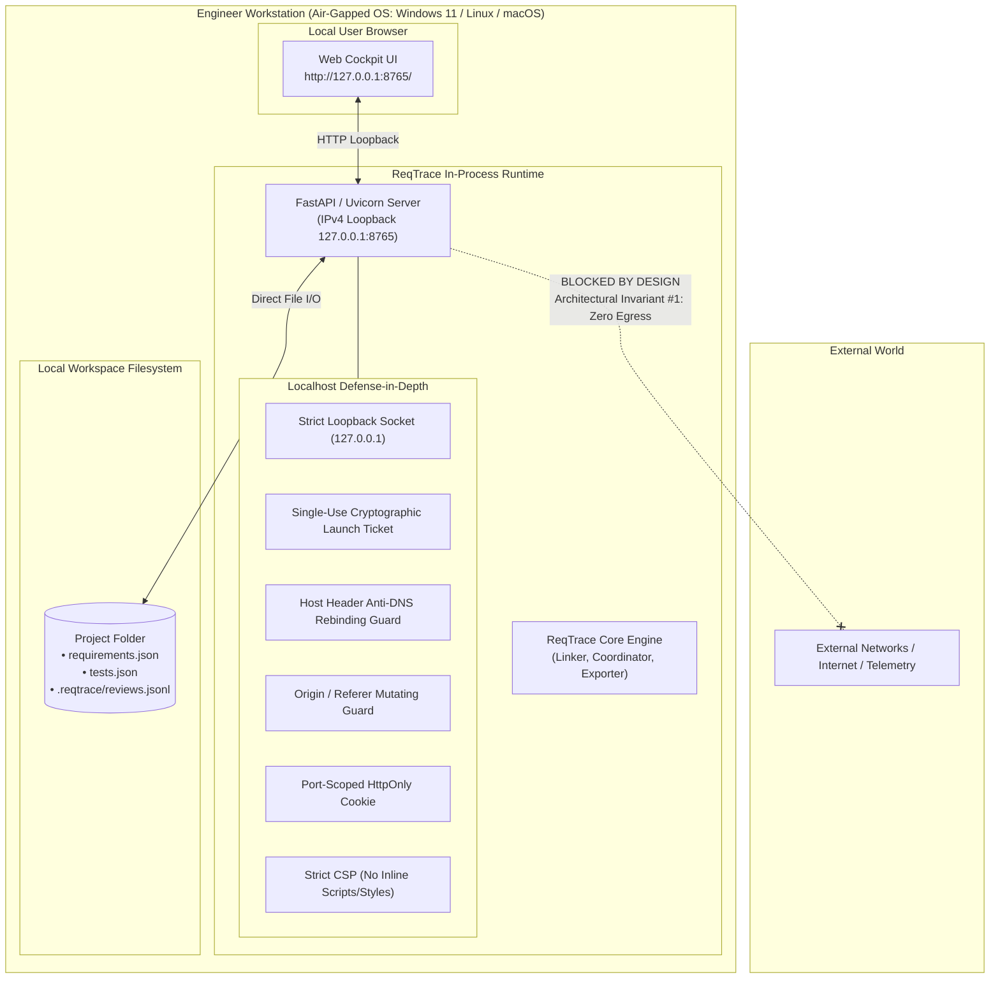

---

### 6.2 Docker Desktop / Local Container Deployment

Used in containerized developer environments where developers mount local project folders into a verified, reproducible container image. Helper scripts and container instructions are provided in [`docs/DOCKER.md`](../../DOCKER.md), [`docker-run.sh`](../../../docker-run.sh), and [`docker-run.ps1`](../../../docker-run.ps1).

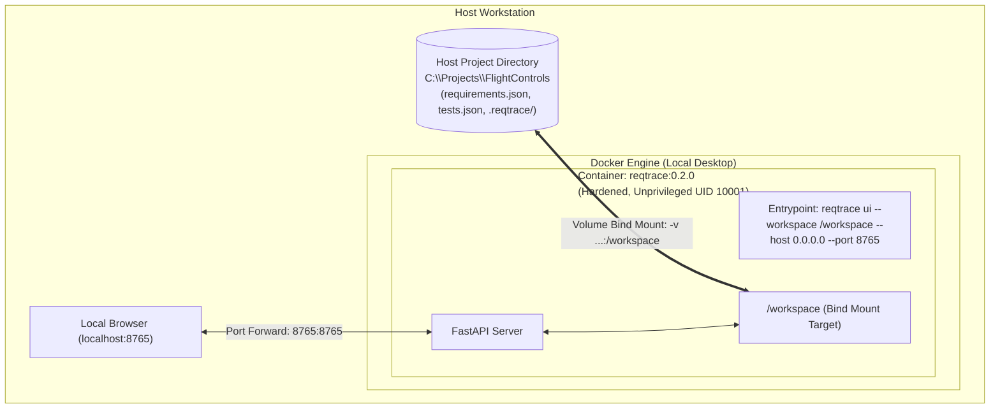

---

### 6.3 Air-Gapped Private Kubernetes (K8s) Cluster Deployment

For private defense labs, avionics enclaves, and qualification testing clusters operating behind secure air-gap perimeters.

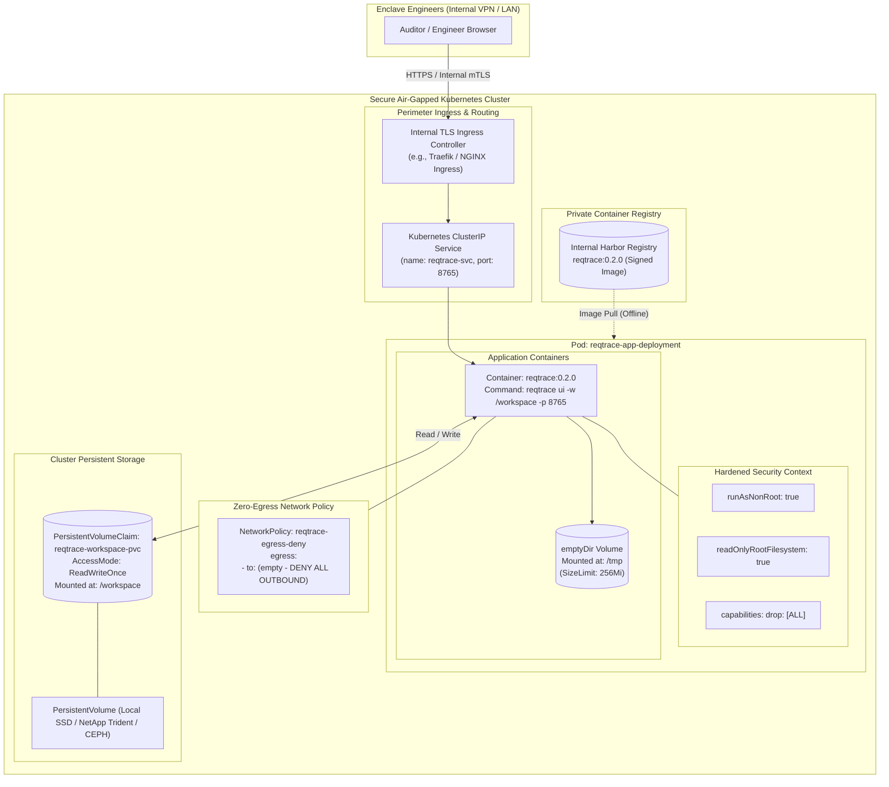

---

### 6.4 Deployment Security Boundary Model

```mermaid
flowchart LR
    subgraph Zone1["ZONE 1: Presentation Tier"]
        Z1_NAME["User Browser"]
        Z1_TRUST["Trust Level: MEDIUM"]
        Z1_CAP["Capabilities:\n• Renders DOM UI\n• Holds session cookie"]
        Z1_REST["Restrictions:\n• No direct filesystem access\n• Sandboxed execution"]
    end

    subgraph Zone2["ZONE 2: Application Process"]
        Z2_NAME["ReqTrace FastAPI Process"]
        Z2_TRUST["Trust Level: HIGH"]
        Z2_CAP["Capabilities:\n• Ingests specs\n• Links requirements\n• Generates deliverables"]
        Z2_REST["Guards:\n• Anti-DNS rebinding\n• CSRF verification\n• Ticket exchange auth"]
    end

    subgraph Zone3["ZONE 3: Storage Tier"]
        Z3_NAME["Workspace Storage"]
        Z3_TRUST["Trust Level: HIGHEST"]
        Z3_CAP["Data Entities:\n• requirements.json\n• tests.json\n• reviews.jsonl (ledger)\n• baselines/"]
        Z3_REST["Guards:\n• Append-only reviews\n• Multi-process FileLock\n• Atomic temp file writes"]
    end

    subgraph Zone4["ZONE 4: External World"]
        Z4_NAME["External Networks / Cloud"]
        Z4_TRUST["Trust Level: UNTRUSTED"]
        Z4_POL["Policy: STRICT DENY ALL\nZero telemetry, zero remote APIs"]
    end

    Zone1 <-->|HTTP Loopback Only| Zone2
    Zone2 <-->|POSIX / Win32 File Locking| Zone3
    Zone2 -.-x|FIREWALL / POLICY BLOCKED| Zone4
```

---

## 7. Backup and Disaster Recovery Architecture

In regulated environments, traceability data constitutes formal safety records. ReqTrace supports atomic point-in-time snapshots, cryptographic validation manifests, and deterministic rehydration.

### 7.1 Atomic Backup Workflow

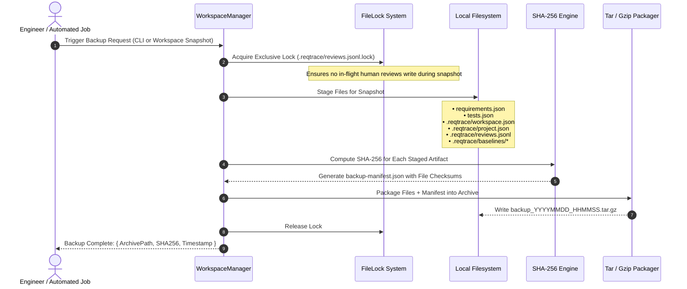

---

### 7.2 Restoration, Integrity Validation & Rehydration Workflow

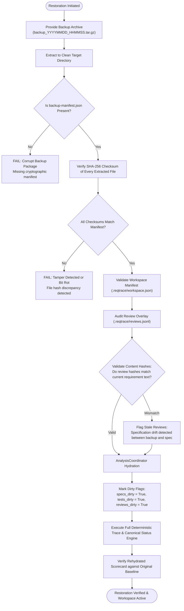

---

## 8. Summary of Architectural Invariants

| # | Architectural Invariant | Enforcement Mechanism |
| :--- | :--- | :--- |
| **1** | **Zero Outbound Egress** | Loopback binding (`127.0.0.1`), offline token generation, zero network telemetry dependencies. |
| **2** | **Data Sovereignty** | Local file storage (`requirements.json`, `tests.json`, `.reqtrace/`), no remote DB requirement. |
| **3** | **Append-Only Ledger** | `ReviewStore` appends immutable event tuples; previous review history is preserved forever. |
| **4** | **Content-Hash Binding** | Review events bind directly to `sha256(requirement_text)`; specification drift marks links stale. |
| **5** | **Reproducible Deliverables** | Deterministic linking and canonical status engine produce identical outputs from identical inputs. |
| **6** | **Review Fast-Path** | Human review sign-offs bypass $O(N \times M)$ text linkers, executing only $O(N)$ status updates in < 1.5ms. |
| **7** | **Option B Workspace Creation** | Directories must exist prior to workspace creation; ReqTrace never silently creates target paths. |

